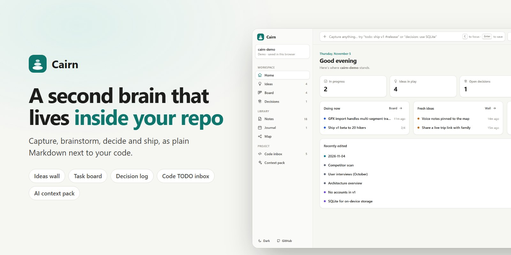
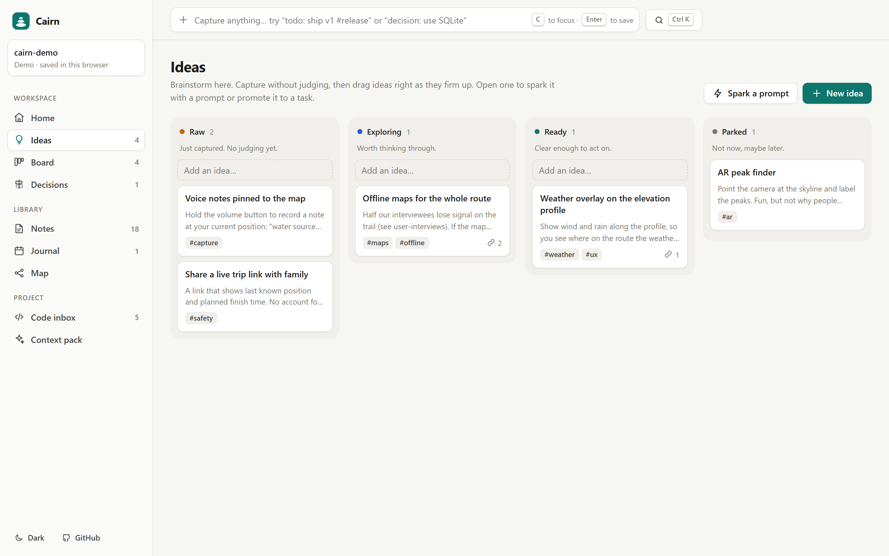
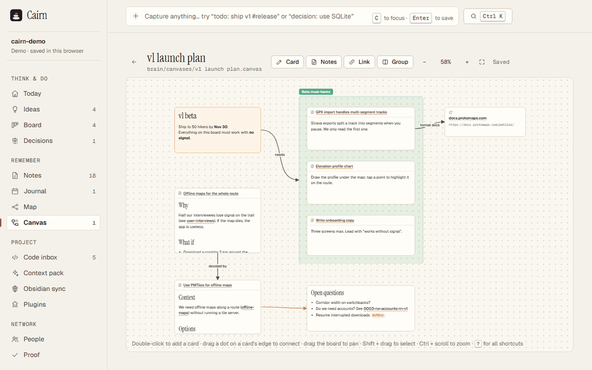
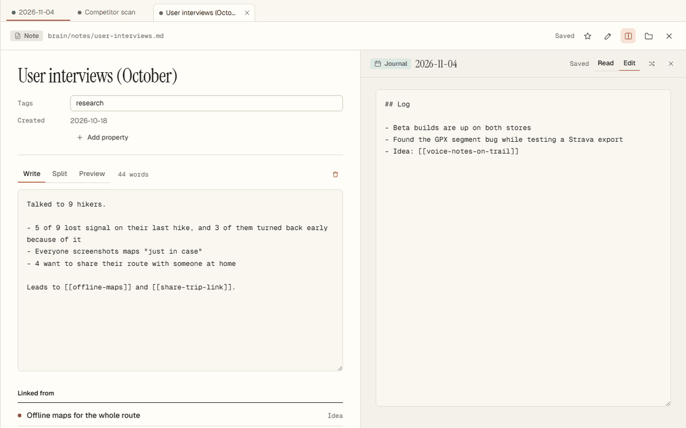
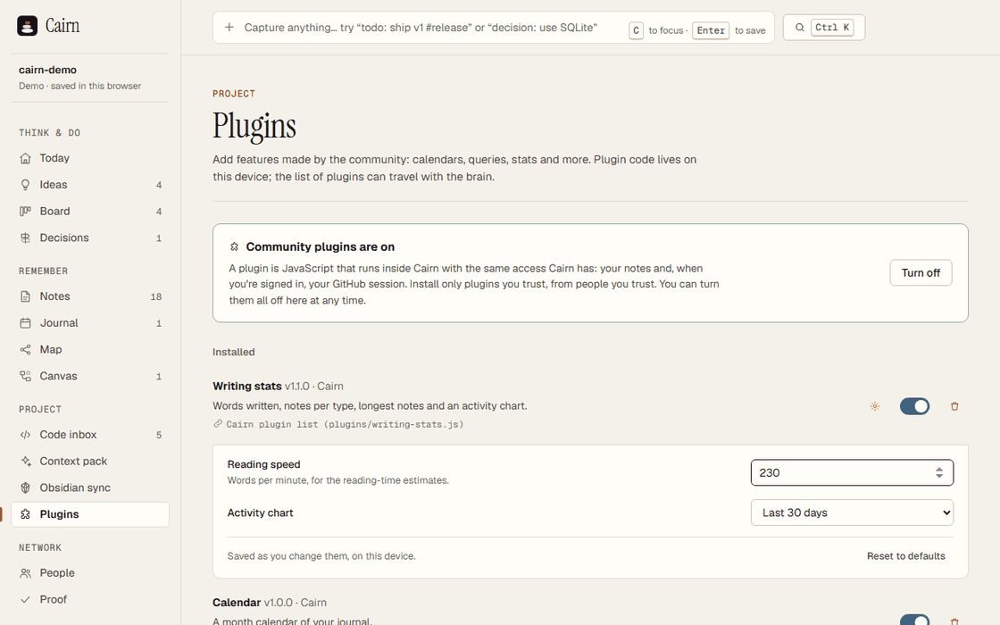
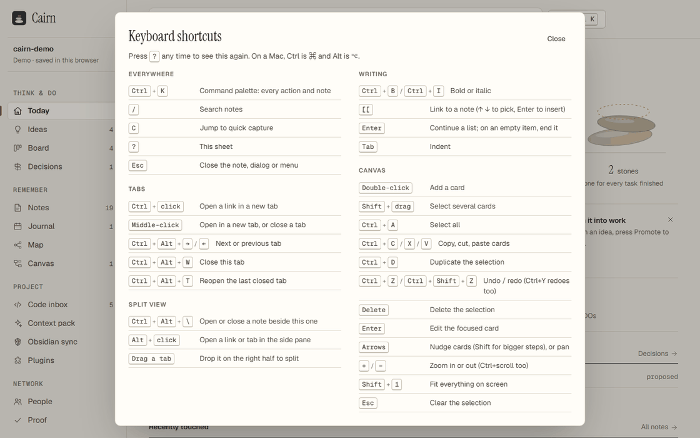

<!-- HERO:START -->
<p align="center">
  <a href="https://juw12.github.io/cairn/"></a>
</p>

<p align="center">
  <b>A second brain that lives inside your repo.</b><br>
  Capture ideas, brainstorm, record decisions and move tasks, all as plain Markdown next to your code.
</p>

<p align="center">
  <a href="https://juw12.github.io/cairn/?demo=1"><b>Try it live</b></a> ·
  <a href="#see-it-in-action">See it in action</a> ·
  <a href="#highlights">Highlights</a> ·
  <a href="https://juw12.github.io/p/cairn/">Landing page</a> ·
  <a href="https://github.com/juw12">More by juw12</a>
</p>

<p align="center">
  <a href="https://github.com/juw12/cairn/actions/workflows/tests.yml"></a>
  <a href="https://github.com/juw12/cairn"></a>
  <a href="https://juw12.github.io/cairn/?demo=1"></a>
  
  
  
  
</p>

<div align="center">

[](https://m8ven.ai/mcp/juw12-cairn-3r8q5g?s=readme) [](https://glama.ai/mcp/servers/juw12/cairn)

</div>

<a id="highlights"></a>
<table>
  <tr>
    <td width="33%" valign="top">
      <b>Plain files, no lock-in</b><br>
      Everything is Markdown in a <code>brain/</code> folder. Delete Cairn and it still reads fine on GitHub, in Obsidian or in VS Code.
    </td>
    <td width="33%" valign="top">
      <b>Knows your code</b><br>
      Turns <code>TODO</code>/<code>FIXME</code> comments into tasks that remember the file and line, and commits the brain in one click.
    </td>
    <td width="33%" valign="top">
      <b>Made for AI assistants too</b><br>
      <code>cairn mcp</code> lets Claude, Cursor, Copilot or OpenCode search and update the brain; <code>brain/CONTEXT.md</code> is a one-page brief for the rest. No API keys.
    </td>
  </tr>
</table>

## See it in action

<p align="center">
  <a href="https://juw12.github.io/cairn/?demo=1"></a><br>
  <sub>Open the interactive demo at <a href="https://juw12.github.io/cairn/?demo=1">juw12.github.io/cairn</a></sub>
</p>
<!-- HERO:END -->

## About

**Your project's thinking is scattered.** Ideas sit in Notion, tasks in GitHub Issues, decisions
in Slack threads, TODOs in code comments, and the "why" lives in someone's head. Obsidian and
Notion are great at notes, but neither knows anything about your repo.

Cairn puts one calm place **inside the project**, built around how project work actually moves:

```
capture  →  brainstorm  →  decide  →  do  →  remember
  bar        ideas wall    decision    board    notes, journal,
  + CLI      + sparks      log                  map, context pack
```

| Screen | What it does |
|---|---|
| **Quick capture** | One bar on every screen. `todo: ship v1 #release`, `decision: use SQLite`, `log: fixed the bug` or just text (an idea). It shows where the note will go before you press Enter. |
| **Voice log** | One **Log** button on every screen: in the top bar on a computer, bottom-right in thumb reach on a phone (or <kbd>L</kbd>). Talk and it writes a timestamped line into today's `journal/YYYY-MM-DD.md`; say *todo …*, *idea …*, *decision …* or *mood good* and it creates the linked note or mood too. *Undo*, *read today*, *what did I do last Friday*, *search for …*, *stop*. Uses the browser's speech engine, or an **offline voice model** that runs on your device; no API key, and typing works everywhere. [More below](#keep-a-daily-log-by-voice). |
| **Ideas wall** | Raw → Exploring → Ready → Parked. Drag ideas right as they firm up. **Spark** drops a thinking prompt into an idea; **Promote to task** creates a linked task. |
| **Board** | To do → Doing → Done with drag and drop, checklists and progress bars. |
| **Decisions** | Lightweight decision records (context, options, decision, consequences), numbered and reviewed in PRs like code. |
| **Journal & memories** | Its own page in the sidebar. One period (7 days to all time, or any number of days) drives the numbers, a **recap with one line per day** (entries, agent sessions, tokens, topics), a mood worked out for you from what you wrote and how busy the day was, a 12-month heatmap, what was on your mind and search across every day. Nothing asks you to write a review. |
| **Notes, Journal** | Markdown editor with preview, `[[wikilinks]]`, backlinks, tags and a page per day. Open notes as **tabs**, and put a second note **beside** the first (columns button, <kbd>Alt</kbd>+click a link or tab, or drag a tab to the right): both stay editable, links in the side note open there, and the layout is remembered. |
| **Map** | A live graph of every note: drag notes (they stay pinned), zoom, pinch, hover to light up neighbours with direction arrows, click for an inspector with summary and links in/out. **Shift-click** two notes for the path between them, **Alt-drag** one onto another to write a `[[link]]`, double-click a hollow "unwritten" link to create that note. Local graph (1-3 hops), search, colour by type / folder / cluster / status, tag hubs, orphan filter, a time-lapse of how the brain grew. Canvas-rendered, smooth with thousands of notes, and every note stays reachable by keyboard. |
| **Canvas** | Infinite boards of notes, cards, links and groups joined by arrows, saved as Obsidian-compatible `.canvas` files. <kbd>Shift</kbd>-drag to box-select, <kbd>Ctrl</kbd>+<kbd>C</kbd> / <kbd>V</kbd> / <kbd>D</kbd> to copy, paste and duplicate (pasting a link, a `[[note]]` or text makes the right card), drag notes in from the **Notes** panel. A note shows the canvases it sits on, and the Map draws each canvas as a square joined to its notes. |
| **Obsidian sync** | Import an Obsidian vault and keep it in sync both ways (notes and canvases). Files are mirrored as they are; nothing is converted. |
| **Databases** | Notion-style databases inside any note: a ` ```database ` block (`type: task`, `where: status != done`, `sort: due asc`, `view: board`) becomes a live **table, board, gallery, list or calendar** of your notes. Filters can be relative (`where: due < today`, `due <= today+7`), so an *Overdue* view stays right every day. Click a cell to edit it, drag a card to another column, press **New** to add a row. Unlike Notion, every row is still a plain Markdown file and every edit lands in its front matter, so Obsidian, GitHub and AI assistants see the same data. The view you pick is saved in the block itself. |
| **/ menu** | Type `/` in the editor for a Notion-style block menu: headings, to-dos, toggles (foldable Obsidian callouts), callouts, tables, code, maths, Mermaid diagrams, links, embeds, dates and databases. Everything it inserts is plain Markdown. |
| **Projects** | Every GitHub repo of a person (yours by default, **Cairn itself always included**; forks, archived and profile/settings repos left out) ranked by how **solid** it is (live demo, tests, CI, codebase size, months of upkeep, README, license) and how much **potential** it has (stars, recent pushes, how often your own notes mention it, whether people can try it). Scores are partly relative to your other repos, so similar projects still spread out. Each card says what sets that repo apart (*Why*) and the concrete step that would lift it (*Next*); advice that applies to most of your repos is shown once above the list. It re-ranks itself every 15 minutes, shows who moved since yesterday, remembers test/CI checks until a repo is pushed again (so it stays inside GitHub's anonymous rate limit) and can keep a *Project ranking* note in the brain up to date. A repo's name opens it **inside Cairn**, so you need not go to github.com to see what was pushed: **Look** shows every picture and video (banners, screenshots and demos first), the folders as cards with a cover and the README; **Pushes** shows the latest commits with the pictures, files and lines each one changed; **Files** opens any file as a picture, video, sound, rendered Markdown or text. Every folder opens the same way, so a repo of many projects can be walked one project at a time. **Releases** shows each release with its notes and files; **Issues and pull requests** opens one with everything said on it, and a pull request with its reviews and changed files. The branch name under the title switches branch. A link to github.com anywhere in Cairn opens that repo, folder, file, push, pull request or issue here (Ctrl or Cmd with the click, or a GitHub button, still goes to github.com). Private repos work when you are signed in as someone who can read them. |
| **Plugins** | Community plugins: install from the list, a GitHub repo or a link. Each plugin gets a **settings page** drawn from its own options, a plugin that breaks is flagged on its row with a **Restart** button, and the list of plugins you use can be **saved into the brain** so your other devices get the same ones: the built-in plugins install themselves, the others ask first (sources only, never code). Write your own in one file ([PLUGINS.md](PLUGINS.md)). |
| **Code inbox** | Every `TODO`, `FIXME` and `HACK` comment in the repo. One click makes a task that remembers `file:line`. Under **Tools** (<kbd>Ctrl</kbd>+<kbd>K</kbd>), with Notes, Context pack, Obsidian sync and Plugins. |
| **Context pack** | A one-page brief (doing now, up next, decisions in force, open questions) saved as `brain/CONTEXT.md` for teammates and AI assistants. |
| **Search** | <kbd>Ctrl</kbd>/<kbd>⌘</kbd>+<kbd>K</kbd> across every note and command. <kbd>C</kbd> jumps to capture, <kbd>?</kbd> shows [every shortcut](#keyboard-shortcuts). |
| **People** | Look up anyone on GitHub and see their proof of work, read from their brain's files: working on, shipped, decisions, open to collaborate. Open their brain read-only and **Ask to join** (opens a prefilled GitHub issue). |

<table>
  <tr>
    <td width="50%" valign="top"><br><sub><b>Canvas.</b> Notes, cards, links and groups on an infinite board, saved as Obsidian <code>.canvas</code> files.</sub></td>
    <td width="50%" valign="top"><br><sub><b>Tabs and split view.</b> Keep several notes open and edit two side by side.</sub></td>
  </tr>
  <tr>
    <td width="50%" valign="top"><br><sub><b>Plugins.</b> Install from the list, a repo or a link; each plugin gets its own settings page.</sub></td>
    <td width="50%" valign="top"><br><sub><b>Keyboard first.</b> Press <kbd>?</kbd> anywhere for every shortcut.</sub></td>
  </tr>
</table>

### Keyboard shortcuts

Press <kbd>?</kbd> anywhere in the app (or pick **Keyboard shortcuts** in the palette) for the full sheet. The ones you'll use most:

| Where | Keys |
|---|---|
| Everywhere | <kbd>Ctrl</kbd>/<kbd>⌘</kbd>+<kbd>K</kbd> palette · <kbd>/</kbd> search · <kbd>C</kbd> capture · <kbd>L</kbd> voice log · <kbd>?</kbd> shortcuts · <kbd>Esc</kbd> close |
| Tabs | <kbd>Ctrl</kbd>+click a link opens a tab · <kbd>Ctrl</kbd>+<kbd>Alt</kbd>+<kbd>←</kbd>/<kbd>→</kbd> switch · <kbd>Ctrl</kbd>+<kbd>Alt</kbd>+<kbd>W</kbd> close · <kbd>Ctrl</kbd>+<kbd>Alt</kbd>+<kbd>T</kbd> reopen |
| Split view | <kbd>Ctrl</kbd>+<kbd>Alt</kbd>+<kbd>&#92;</kbd> open/close · <kbd>Alt</kbd>+click a link or tab · drag a tab to the right half |
| Writing | <kbd>Ctrl</kbd>+<kbd>B</kbd>/<kbd>I</kbd> bold/italic · <kbd>[[</kbd> link a note · <kbd>Enter</kbd> continues a list |
| Canvas | double-click add · <kbd>Shift</kbd>+drag select · <kbd>Ctrl</kbd>+<kbd>C</kbd>/<kbd>V</kbd>/<kbd>D</kbd> copy/paste/duplicate · <kbd>Ctrl</kbd>+<kbd>Z</kbd> undo · arrows nudge · <kbd>Shift</kbd>+<kbd>1</kbd> fit |

## Use it

There are four ways to run it. All of them read and write the same plain files.

**0. Desktop app for Windows (easiest).** [Download `Cairn-Setup.cmd`](https://juw12.github.io/cairn/Cairn-Setup.cmd)
and double-click it, or paste this in PowerShell: `irm https://juw12.github.io/cairn/install.ps1 | iex`.
No admin rights needed. It installs whatever is missing (Python, Git, the window and tray libraries), then opens
Cairn in its own window. After that, everything happens inside the app:

- **Your notes open by themselves.** The first time, Cairn opens the Obsidian vault you used last (or a fresh
  brain in `Documents\Cairn`). **Switch brain** opens another folder, **gets a repo from GitHub** (private
  ones too; GitHub's own sign-in window appears once), or starts a new brain.
- **One Sync button.** It saves your edits, gets everyone else's and sends yours (commit + pull + push). It also
  runs on its own every 10 minutes. If two people changed the same lines, nothing is lost: your edits stay
  committed locally and Cairn tells you. Behind an office proxy, Sync tries every way out it can find (git's own
  setting, the Windows proxy, `HTTPS_PROXY`, signing in to the proxy as you) and remembers the one that works.
- **Your public brain stays current.** In Settings, name your public repo (e.g. `you/brain`) and turn on
  *Publish automatically*: after each sync, notes marked `publish: true` are published, but only when one of
  them changed. The same notes go online as a web page anyone can read and search, at
  `https://you.github.io/brain/` ([below](#a-web-page-anyone-can-search)).
- **Always there.** Closing the window keeps Cairn in the tray and it starts with Windows.
- **Updates itself, no restarts.** Cairn checks for a new version every 20 minutes. Changes to the app's
  screens are swapped in with a quick reload the moment you pause (your open note stays open); the rarer
  changes to its engine restart Cairn quietly while it's in the tray, or after a couple of idle minutes,
  and bring the window back where you were. **Settings** turns each of these on or off.

**1. Local app from the terminal.** Python 3.13+, no dependencies:

```bash
git clone https://github.com/juw12/cairn
cd your-project
python -m cairn --root .          # run from the cairn folder, or `pip install ./cairn` and run `cairn`
```

It opens `http://127.0.0.1:4777` with code scanning and one-click **Commit brain** (commits only `brain/`; push with your usual git tool).

**2. In the browser, on your real repo.** Open [juw12.github.io/cairn](https://juw12.github.io/cairn/), choose
**Open a repo folder**, and pick your project. Chrome and Edge on desktop can read and write the folder directly
(File System Access API). Nothing is uploaded.

**3. Demo.** [Try the sample project](https://juw12.github.io/cairn/?demo=1) (an offline hiking app). It's saved only in your browser.

### Watch your vibe coding live

**Vibe** (sidebar → Build) shows what your AI assistant is doing right now, what came out of it, and what people
thought. A session is a plain file in `brain/sessions/` with `status: live` while you work and a log of timestamped
steps; feedback lives in `brain/feedback/` with an optional 1-5 rating.

Every block on the Vibe page (live recap, overview, numbers, activity, sessions, skills, models...) folds to one
line with a summary, and moves up or down with its arrows or by dragging its handle. Every other page is built the
same way (Today, Board, Ideas, Decisions, Journal, Projects, Chat, Autopilot, Map, Canvas, People, Proof, Notes and
the Code inbox), each with a **Dashboard** (the numbers) and a **Recap** (what changed and what needs you). On Chat
and the Map the tool comes first and the two blocks sit under it; move them where you like. The layout is saved in
`brain/CAIRN-LAYOUT.md` (one `page-order:` and `page-folded:` line per page), so the desktop app, the web app and
your phone show the same pages.

The **Live recap** is the one list of sessions that are open: each row says *working*, *turn finished*, *stopped on
an error* or *left open*, and opens to the full session (progress, steps, add a step, end it). Its sections
(running, left open, just finished) and each assistant in the overview (OpenCode, OpenBot, Vector...) fold too.
A session counts as running only while it is doing something: nothing ever waits for you to press a button.
Blocks with nothing in them stay away (feedback before the first `fb:` note, models that used no tokens).

```sh
cairn vibe start "add dark mode" --agent claude   # opens a live session
cairn vibe log "asked for a theme toggle" --kind prompt
cairn vibe log --progress 40 "wiring the toggle"     # how far along it is: drives the live bar and time left
cairn vibe skill /refine "6.5 -> 8.7"              # skill runs: /refine, /council, /ambitious-founder, /precedent...
cairn vibe check -- python -m pytest               # runs your tests, logs pass/fail with the summary line
cairn vibe end --result shipped "toggle works"     # records commits and +/- lines since the start
cairn feedback "toggle is hard to find on mobile" --rating 3 --from @alice
cairn vibe status                                  # the same stats in the terminal
```

Paste the instructions from the Vibe page into `AGENTS.md` or `CLAUDE.md` and your assistant reports its own
progress. Any logged step that starts with a slash command counts as a skill run, and the page tallies them.

- **Progress, time left, effort:** every live session gets a percentage bar, an estimated time left and a
  Light / Medium / Heavy effort badge with the reasons (time so far, lines and files changed, checks and failures).
  The percent comes from what the agent logs (`--progress 40`, `[40%] ...`, `step 3/7`); without that, Cairn
  estimates it from your own finished sessions (same agent when there are 10+), and says so on the card.
- **Parallel agents:** run several sessions at once (one per terminal or git worktree). `start` prints the
  session's slug; set `CAIRN_SESSION` to it in that terminal (or pass `--session`) and every command goes there.
- **Live everywhere:** the local app updates within seconds, with commits and changed files counted since the
  session started (exactly, from the commit it began on). A folder opened in Chrome or Edge refreshes every few
  seconds. A GitHub brain you're signed in to refreshes every 20 seconds with conditional requests, so unchanged
  checks don't use up your rate limit.
- **Demo:** *Load a sample week* on the Vibe page of the [demo](https://juw12.github.io/cairn/?demo=1). Stats: sessions, time, ship rate, checks passing, a 14-day activity chart, open feedback and the average
rating. No streaks, no leaderboards: everything is evidence you can open as a file.

#### Detect sessions automatically

`cairn vibe watch` notices AI coding sessions without anyone typing `vibe start`:

```sh
cairn vibe watch --once          # one sync, then exit
cairn vibe watch                 # keep watching (every 60 s; --every 30)
cairn vibe watch --everywhere    # OpenCode sessions from any folder, not just this repo
cairn vibe watch --install       # start hidden at Windows sign-in (--uninstall removes it)
```

The desktop app does this on its own while it runs (Settings → *Record AI coding sessions*), so you only need
the command without the app. An Obsidian vault takes sessions from every folder; any other brain only its own.
Only one watcher writes a brain at a time: if the app, a startup watcher and a terminal all run, the others
stand by and take over within five minutes of it stopping.

- **OpenCode:** each session in OpenCode's local database becomes a session note (`source: opencode`) with active
  minutes (gaps between messages, capped at 10 minutes) and when they happened (`spans`), model and cost. OpenCode
  does not record line changes, so the watcher also counts the commits made in the session's folder while it ran
  (local branches, no merges, no `[bot]` authors). It is `live` only while a turn is running: the moment the
  assistant finishes its turn the session ends (`shipped` if it changed or committed code, otherwise `done`), and a
  new message opens it again. A session deleted from OpenCode's database (bots that clean up after themselves) is
  closed too. The log says whether the folder had no commits or is not a git repo at all.
  Re-running is idempotent and finished sessions are not re-read, and a status you set by hand is kept until the
  session moves again. Subagent and archived sessions are skipped.
- **Vector:** when the Vector app is running and this repo changes, a session opens; new commits are logged, and it
  ends when Vector closes or the repo has been quiet for 30 minutes (`shipped` with commits, else `partial`).
  Detection is from the outside only (process list and git), so it can't see what was asked. For prompts and steps,
  let the assistant report itself with `cairn vibe start/log/check/end`. A self-reported session that never says
  `vibe end` is closed after four hours without a step, and its next `vibe log --session <slug>` opens it again.
- **Privacy:** the OpenCode database is opened read-only and only session metadata and message timestamps are read,
  never message text. Nothing leaves your machine. `--no-opencode` and `--no-vector` turn either source off.
- **Several computers:** every session note names the computer it ran on (`machine:`), so two computers can write
  into one brain. Sync the brain between them the way you already do (git), run Cairn on each, and the Vibe page
  gets a device bar: **All devices** with the totals together, or one computer alone with its own sessions, live
  count, tokens and load reading. The first pass on a computer takes every session its OpenCode still has, not just
  the last 14 days (`--days 0` does that again later). A watcher only opens and closes the sessions of its own
  computer. Another computer is as current as its last sync into the brain. `cairn vibe device` shows the name in
  use (`CAIRN_DEVICE=...` sets another), and `cairn vibe device --adopt`, run once on the computer that made them,
  puts its name on older sessions that name none. On a Mac the load reading comes from `vm_stat`, `pmset` and `ps`.
- **GitHub Actions minutes:** with a GitHub token (the one `cairn publish` uses) the watcher reads your Actions
  usage once an hour and keeps one note per month in `github-usage/`. The Vibe page shows this month's free
  minutes as a meter, warns at 75%, 90% and 100% (or when the last 7 days' pace would pass 100% by month end),
  and keeps the daily and monthly history. Only private repos count; it is an estimate and GitHub's own meter
  decides. The calls only read; `--no-github` turns them off.
- **A second GitHub account:** minutes count for the account that owns a repo, whoever pushes to it. If the
  GitHub CLI is signed in to another account of yours (`gh auth login`, with the `user` scope so it may read
  billing: `gh auth refresh -h github.com -s user`), `cairn vibe watch --github-account NAME` notes its minutes
  too, in `github-usage/NAME/`, and the Vibe page shows a meter for each account. In the desktop app the setting
  is `vibeWatchGithubAccounts`. One computer can write the main account's note and another the second account's
  (`--no-github --github-account NAME`), so two never write the same note. `cairn vibe github --account NAME`
  reads or sets that account's figure.
- **Moving a repo's minutes:** when one account is nearly out and another has room, the meter offers the busiest
  private repos with a button, **repo → other account** (or `cairn vibe github move REPO --to NAME`). It asks
  GitHub to transfer the repo: GitHub mails the new owner, nothing moves until that link is opened (within a
  day), the old owner stays on as a collaborator and can still push, and the old address redirects. Only between
  accounts signed in on this computer, only for private repos, only from Cairn on the computer itself (never
  from a paired phone), and never without a confirmation. Mind GitHub's terms on how many free accounts one
  person may hold.
- **Which account this computer pushes as:** where the GitHub CLI is signed in to several accounts, the Vibe
  page shows **Pushes from this computer** with a chip per account, the one in use pressed (or
  `cairn vibe github push-as [NAME]`). A press runs `gh auth switch`; the first press also runs
  `gh auth setup-git`, after a confirmation, so that git asks the GitHub CLI for its GitHub sign-in. From then
  on `git push`, `gh` and an assistant working on that computer all go out as the account picked, and a switch
  made in a terminal shows on the page within seconds. Commits keep their author; only the sign-in changes,
  the name GitHub puts on a push, a pull request and a release. It is checked on the computer, by comparing
  the sign-in git would send with the CLI's, and no token is shown or stored. Never from a paired phone. A repo
  whose address names a user or uses SSH keeps its own sign-in. To undo the first press:
  `git config --global --unset-all credential.https://github.com.helper` (and the same line for
  `gist.github.com`, which the GitHub CLI sets along with it).
- **A copy of every repo on this computer:** `cairn vibe github copy FOLDER` keeps a full copy (a git mirror:
  every branch, every tag, the whole history) of every repo of the accounts the GitHub CLI is signed in to, in
  `FOLDER/owner/name.git`, so that GitHub is not the only place your work exists. A locked account, a deleted
  repo or a force-push then costs nothing: `git clone FOLDER/owner/name.git` gives the work back, and
  `git --git-dir FOLDER/owner/name.git push --all NEW-URL` (then `--tags`) puts it on another host. Beside each
  mirror, `FOLDER/owner/name.extras/` holds what is not in git: issues and pull requests with their comments
  (`issues.json`, `comments.json`, `review-comments.json`), releases and the files attached to them
  (`releases.json`, `releases/TAG/FILE`), the wiki (`wiki.git`), what the repo page says (`repo.json`) and the
  Actions variables with the names of the Actions secrets (`actions.json`). Git LFS files are fetched into the
  mirror. One thing nobody can copy: the value of an Actions secret, which GitHub never gives back, so only its
  name is kept. The folder is remembered per computer, later runs (`cairn vibe github copy`) fetch only what
  changed since (and look at every repo's extras once a week), and the watcher does that once a day. A repo
  that is gone from GitHub keeps its copy. `--account NAME` copies one account only. The sign-in goes to git and
  to GitHub for one request at a time and is never written into the copy.
  One disk is one accident away from none. `cairn vibe github copy everywhere` asks every other computer whose
  watcher reads the same brain to keep its own copy, in `github-copy` in its home folder, once it has the room
  and the GitHub CLI is signed in there (`everywhere off` stops asking). That holds on a computer whose watcher
  runs with `--no-github` too, since each computer writes only its own note; `cairn vibe watch --no-copy`
  keeps one computer out. A note per computer in
  `github-usage/copy/` says how many repos it holds, how big and how fresh, and the command says whether this
  computer's copy is the only one. Cairn does not replace GitHub as the place others find your work or your
  devices sync through; it makes losing it survivable.
- **On the page:** sessions are grouped by day (click a day to fold it) and the outcome chips (shipped, no code
  change, no git) double as the legend and as filters. Day totals are clock time too.
- **Time vibing** is clock time with at least one session working: two agents running side by side for an hour count
  as one hour, so it can never exceed the length of the day. The summed agent time is shown next to it as
  "N× in parallel".

### Watch and control it from your phone

Pair a phone the way `opencode pair` does: in the desktop app open **Settings > Pair a phone** (or the tray icon's
*Pair a phone...*, or run `cairn pair` in a terminal) and scan the QR code. The phone opens straight on the Vibe page
and stays paired, so a home-screen bookmark keeps working: live sessions, autopilot jobs and notes, from the couch.

- **Control, not just watch:** the phone gets the full app (capture, edit notes, move tasks, start, comment on or stop
  autopilot jobs), minus the desktop-only controls such as Settings and updates.
- **Chat:** the *Chat* page is a plain chat with the AI models of the OpenCode on your PC (company builds such as
  PEGAAi OpenCode included): pick a model, type, send, and the answer appears on whichever device you are on. Chats
  keep their context and live in `~/.cairn/chats`. The *Glow* tab next to it opens your Glow app (Chat, Council, Arena).
- **Chat from anywhere (GitHub relay):** when the phone can't reach the PC at all (outside the office network,
  no Tailscale), Chat goes through a private GitHub repo instead. On the PC run `cairn relay setup` once: it creates
  the private repo `<you>/cairn-relay` and saves your GitHub token encrypted for your Windows user in
  `~/.cairn/relay.json`; the desktop app then answers from it. On the phone open
  [Cairn](https://juw12.github.io/cairn/), sign in with a fine-grained token limited to that repo (*Contents: read and
  write*) and open *Chat*: messages land in `devices/<pc>/requests/`, that PC runs them and streams the answer into
  `devices/<pc>/threads/`, and the page shows when the PC last checked in. Expect roughly 5-15 s before the reply
  starts. **Several PCs:** run `cairn relay setup` (optionally `--name "Home PC"`) on every PC signed in to the same
  GitHub account; each gets its own folder in the repo and the phone shows a *Talk to* picker to choose which one
  answers, with each PC's own chats and models. Keep the repo private: anyone who can push to it can make your PCs run
  OpenCode prompts, and your chats are stored there.
- **Sign in a phone from any network:** *Settings > Sign in a phone (any network)* shows a QR code that signs the phone's
  browser in to [Cairn](https://juw12.github.io/cairn/) with this PC's GitHub sign-in (the one `cairn relay setup` saved)
  and opens this brain from its GitHub repo. *Copy link* does the same for another browser. Show it only to your own
  devices; revoke the sign-in on GitHub to cut a device off.
- **Live sync:** a change on the phone shows up in the open PC window within a few seconds without a reload, and back
  the other way. A note you are typing in is left alone until you pause.
- **Any network:** put both on [Tailscale](https://tailscale.com) (same account). *Settings > Set up Tailscale* installs
  it on the PC, opens the phone port to Tailscale devices only and turns on *Run unattended*. The QR code then uses the
  PC's Tailscale name (`my-pc.tail1234.ts.net`), so the paired phone works on mobile data or any Wi-Fi. Without
  Tailscale, phone and PC need the same Wi-Fi.
- **Always connected:** Cairn starts with Windows, re-opens the phone port every minute if it dropped, and (by default)
  keeps the PC from sleeping on its own while phone access is on. Closing a laptop lid still sleeps it.
- Each QR code works once and expires after 5 minutes. A paired phone gets a random device cookie (only its hash is
  stored); *Unpair all phones* in Settings cuts every phone off at once, and unticking *Let paired phones connect*
  closes the port.
- If the phone can't connect, Windows Firewall may be blocking Python: allow it on private networks.

### Let your computers leave messages for each other

One brain, several computers: a laptop at home, one at work, a Mac for the things only a Mac can check, a
phone. What one of them found, left hanging or cannot do itself used to get lost between them. Now it leaves
a message.

```bash
cairn handoff                                          # what the other computers left for this one
cairn handoff send "Buddy 1.13 is untested on a real Mac" --to "macbook" -m "Run the self-test, tell me what the log says."
cairn handoff send "Pull Cairn before the next session" --to all
cairn handoff show "buddy"                             # one conversation in full
cairn handoff pickup "buddy"                           # this computer has taken it on
cairn handoff reply "buddy" "Which macOS do you want it on?"
cairn handoff done "buddy" "24 of 24 checks pass. The update check fails: see pull request 45."
cairn handoff close "pull cairn" "Everyone has it."    # over, for every computer
cairn handoff --all                                    # also what is between other computers, and what is settled
```

- **Who it is for:** `--to` takes a computer's name or a few words of it (`macbook` for `MacBook Pro 15,4`),
  several times for several computers, or `all` for every computer. A computer is known once it has written
  into the brain (a session, its `machines/` note or a message). `cairn vibe device` shows this one's name.
- **Where it stands:** a conversation is for one computer or many. Each one says `pickup` when it takes it on
  and `done` when its part is finished; anyone can `reply` in between, also a computer it was not for. It is
  settled when every computer it was for has said `done`, when the one that started it says `done` itself, or
  when anyone says `close`, which calls it off for every computer.
- **In the app:** the Today page has a block **Between computers**: *For this computer* first, then *This
  computer is waiting for*, then what is between the others, with **Picked up**, **Done**, an answer box and
  **Close for everyone** under each conversation, and a form to leave a new message.
- **A phone takes part:** the web app and a phone go by a name kept in that browser (*Phone* until you press
  **Rename**). A message can be for that name, and the phone picks up, finishes and closes like a computer.
- **It leaves at once, where the brain is set up for it.** The desktop app with automatic sync on sets that up
  by itself (`git config cairn.sync auto` in the brain's repository); your own sync script works too
  (`git config cairn.sync "/path/to/sync.sh"`). Then `cairn handoff send` and an answer push right away and
  say so, `cairn handoff` fetches before it lists, and while the app is open it asks the remote every 20
  seconds whether something new is there, so the other computer's message shows without a reload. Without
  that setting nothing is pushed for you: the message goes with the brain's next sync, and the command says
  so. `--offline` skips the network for one command.
- **The order holds when clocks do not.** A message carries the writer's own time, the same moment in UTC
  (`sent`), and the message it follows (`after`). Two computers in different time zones read the same order,
  and an answer never shows before what it answers, even from a computer whose clock is wrong.
- **How it travels:** every message is its own Markdown file in `brain/handoffs/`, written once by the
  device that says it and never changed. Two devices never write the same file, so the brain's git remote
  (or any folder sync) carries the conversation with nothing to merge.
- **For assistants:** `cairn mcp` has `handoffs`, `handoff_send` and `handoff_answer`, and tells an assistant
  to look at the start. The memory skill that `cairn connect` puts into your AI app says the same
  (`recall.py handoffs`, `remember.py handoff`, `remember.py answer`), and so do the agent instructions on
  the Vibe page. An assistant that stops with something only another computer can do leaves it there.

### Get a daily status report in Telegram

A Telegram bot of your own tells you once a day whether Cairn is healthy and what the day held, and answers
`/status` whenever you ask:

```
Cairn on MY-PC · Tue 17 Nov
All good.

Today
6 AI sessions: 4 shipped, 1 partial, 1 still live
3h 05m of session time · checks: 12 passed, 0 failed
Live now: Fix the map on phones
Tasks: 4 to do, 1 in progress

Cairn
Desktop app 1.0.0 (5ba5fd8): running
Brain "brain": in sync with GitHub
Session watcher: running
Phone access: on, 1 phone paired
```

The first line under the date is the verdict: `All good.` or `Needs a look: ...` with what is wrong (the desktop
app is not running, the brain has work that is not on GitHub, the session watcher stopped, checks failed, GitHub
Actions minutes are running out). If the PC has been off or asleep, the report says since when.

```bash
cairn telegram setup <bot token>   # token from @BotFather's /newbot; then open the link it prints (--hour 8 for mornings)
cairn telegram show                # print the report here, send nothing
cairn telegram send                # send it now
cairn telegram status              # what is connected
cairn telegram off                 # forget the bot
```

The bot runs on a small free Cloudflare Worker rather than on the PC, because office networks often block
Telegram and a PC that is off cannot say so. Deploying it takes about ten minutes:
see [`worker/README.md`](worker/README.md). Only the report text leaves the PC (session titles, counts, sync
state), and nothing is sent until you set a bot up.

### Hand over a goal: precedent and autopilot

Say what you want once and get what you would have asked for next. `cairn precedent` learns from your own
history (past prompts in Claude transcripts and OpenCode's local database, your `Update Log`, lessons you logged)
and writes a brief for any goal: a draft Definition of Done, the *hidden asks* (what you asked for after similar
goals before), the closest past prompts, your working profile (`brain/notes/precedent-profile.md`), the queue and
the loop to follow. Any assistant can read it through MCP (`precedent_brief`, the `precedent` prompt) or the
`/precedent` command that `cairn precedent install` writes for Claude Code, OpenCode and Codex.

```bash
cairn precedent learn                       # build the library in ~/.cairn/precedent (redacts tokens and passwords)
cairn precedent brief "landing page for the new app"
cairn precedent queue "add CSV export" --auto   # a #queue task; --auto = safe unattended, --needs-me = waiting on you
cairn precedent next                        # the next open queue item
cairn precedent log "goal" "what shipped" "what you corrected"
cairn precedent install                     # /precedent for Claude Code, OpenCode and Codex
```

The **Autopilot** page (and `cairn autopilot`) goes one step further: hand over a goal and Cairn runs *your* coding
agent round after round (OpenCode by default, or any command such as `claude -p`) until it reports `STATUS: DONE`,
gives it a couple of polish rounds, marks the queue task done, logs the lesson and takes the next `#auto` item.
You watch the live log, steer with a comment, and get a Windows notification when it needs you.
A round that fails with no reply (connection lost, gateway down) is not counted: the job waits 30 seconds to
10 minutes and tries again by itself, and only asks for you after about a day of failed tries.

```bash
cairn autopilot add "add dark mode to settings, tests passing" --workdir ~/code/app
cairn autopilot on                          # the desktop app or `cairn serve` runs the worker (one per machine)
cairn autopilot status
cairn autopilot set engine=command command="claude -p"
```

The queue is plain tasks tagged `#queue` in `brain/tasks/`, so it shows on the Board and in Obsidian too. Cairn
itself still never calls a model: it starts the agent CLI you already use, with your own login. The worker is off
until you turn it on, and its state and logs live in `~/.cairn/autopilot` (`CAIRN_HOME` moves both).
Moving from the standalone precedent skill or Precedent Agent app:
`cairn precedent init --import-skill <skill folder> --queue-file <Queue.md> --agent-app <app folder>` (safe to re-run).

### Keep a daily log by voice

Press the **Log** button, or <kbd>L</kbd>. On a computer it sits in the top bar next to search; on a phone it floats bottom-right where your thumb is, and slides out of the way while you scroll down to read. The microphone starts (you can turn that off), you talk, and every sentence lands in today's page as a plain Markdown bullet:

```markdown
## Log

- 08:12 Walked to work, sorted the GPX bug on the train #beta
- 09:40 Task: [[book-the-train-to-lyon|Book the train to Lyon]]
- 18:05 Mood: good (4/5)
```

| Say | What happens |
|---|---|
| anything | a timestamped line in today's log |
| *todo …*, *remind me to …* | a task on the board, linked from the log |
| *idea …*, *decision …*, *note …* | that note, linked from the log |
| *mood good*, *I feel tired* | a mood line (1-5) for the mood chart |
| *undo*, *scratch that* | removes the last line (and the note it made) |
| *read today*, *what did I do last Friday*, *how was 3 November* | reads that day back aloud |
| *open today*, *open 3 November* | opens that day's page |
| *search for the export*, *when did I last mention Sam* | searches every day and reads out the latest hit |
| *weekly review*, *stop* | writes the review, stops listening |

"Hey Cairn" in front is fine and ignored. **Keep listening** logs line after line hands-free; **Review before saving** puts what you said in the box first. Pick the **speech language** in the sheet (English, 中文, Bahasa Indonesia, Español, Français, Deutsch and more). Turn on **Listen for "Hey Cairn"** and the mic waits in the background while Cairn is open: say *"Hey Cairn, finished the export"* on any screen and the line is logged (a small dot on the button shows it is listening; it pauses when the tab is hidden). Write `@sam` to tag a person; once someone has been @mentioned, saying "lunch with Sam" links them too, and Journal lists the people on your mind.

Speech recognition is the browser's own (Chrome, Edge, Safari), which usually needs a connection. For voice without one, open **Offline voice** in the sheet: download a small speech model for your language (English, 中文, Deutsch, Español, Français, Italiano, Português, Русский and a few more, 30-50 MB, [Vosk](https://alphacephei.com/vosk/)) or pick a model file you already have. It is kept in the browser, recognition runs on your device, and Cairn switches to it on its own when you go offline or the browser's speech service fails; tick *Use it even when online* to always keep audio on the device. In Chrome versions that can recognise speech on the device, the same panel offers **Install it** for the browser's built-in local engine. Wake words are matched loosely, so "hey Karen" or "hey Cairo" still count. In browsers without it the mic is greyed out and the box works the same with typed prefixes (`todo:`, `idea:`, `mood:`). Nothing is sent anywhere by Cairn, and read-only brains never show the button.

**Journal** turns the pages into memory. Pick a period once (7, 30 or 90 days, a year, all time, or type any number of days) and the whole page follows it: your streak, days logged, the busiest day, agent sessions and tokens, with the all-time totals beside them. The **Recap** is one line per day (mood, entries, sessions, tokens, top topics); open a day for its short summary, or jump straight to yesterday, a week, a month or a year ago. The **mood** is worked out for you: a mood you set yourself wins, otherwise it is read from the prompts you typed to your agents, from how the day's lines read (trouble counts three times) and from how busy the day was against your usual day, and the row says why. Cairn's own `journal/` page is the one shown for a date even when another app keeps a page with the same date. Below that: a heatmap of the last 12 months, the people, tags and notes that were on your mind, days that share links with today, and search across every entry (exact hits first, then close matches, so a typo like *weathr* still finds the weather). The log sheet keeps keyboard focus inside it until you close it. Nothing on the page asks for a review. If you want one anyway, say *weekly review* or *monthly review* in the log sheet: it collects the entries, moods, finished tasks and new notes into `journal/2026-W45.md`, a normal note that shows up on the Map and in backlinks.

### Share your brain and explore others

Cairn uses GitHub as the network, so there is nothing new to sign up for.

1. Keep `brain/` in a **public** repo and add the topic `cairn-brain` (repo page → About → Topics).
2. Share your profile link: `https://juw12.github.io/cairn/?u=<your-username>`, or a brain directly:
   `https://juw12.github.io/cairn/?brain=<owner>/<repo>`.

This repo dogfoods it: see [@juw12's profile](https://juw12.github.io/cairn/?u=juw12) or
[Cairn's own brain](https://juw12.github.io/cairn/?brain=juw12/cairn). Only repos with the topic ever appear;
other people's brains are always read-only. Unsigned GitHub API calls are limited to 60 per hour per IP, so
results are cached for 10 minutes.

### Show proof of work

Write a claim as a note with a `claim:` line and links to the work under `evidence:` (repos, merged
pull requests, commits, releases). The **Proof** view and everyone's profile check each link on
GitHub and show a level nobody can type in: L1 claimed, L2 backed by work you own, L3 used by others
(merged into someone else's repo, forked or starred), L4 vouched (another person committed a vouch
file in their own repo; the **Vouch** button prefills it). Keep your brain private and publish only
the notes marked `publish: true`:

```sh
python -m cairn publish --to YOUR-NAME/brain --source "path/to/your/vault"
```

The full format is in [PROOF.md](PROOF.md).

<a id="a-web-page-anyone-can-search"></a>
**A web page anyone can search.** The same commit puts those notes in the public repo's `docs/` folder as
a web page, and switches GitHub Pages on for it, so your public brain is online at
`https://YOUR-NAME.github.io/brain/` (see [@juw12's](https://juw12.github.io/brain/)). Nobody needs
Cairn, a GitHub account or a sign-in to read it:

- **Search box** over every public note. Every word you type must be in the note; a word in the title
  counts most, then a tag, then the text. `/` jumps to the box, and the address keeps the search
  (`?q=offline+voice`), so a search can be sent as a link. The words travel with the page in one small
  script, so no server is asked and there is no rate limit. Without JavaScript the box is not shown and
  the pages read the same.
- **Found by Google and Bing.** Every note is its own plain HTML page with a title, a description and its
  own address, and `sitemap.xml` lists them all with the day each last changed.
- Only the owner of a repo can switch GitHub Pages on. If you publish as a collaborator, Cairn says so
  and names the one setting (repo Settings → Pages → Branch `main`, folder `/docs`); the next publish by
  the owner does it by itself.
- A repo that already keeps something else in `docs/` is left alone, and `--no-site` publishes the notes
  without the page.

### Share a page without GitHub

Want a link you can send to anyone, with no repo, topic or token? Build a plain web page from the
same `publish: true` notes:

```sh
python -m cairn publish --site my-page --title "Your Name"
```

`my-page/index.html` lists your work (each claim with the links that back it) and every public note
gets its own page. It is plain HTML with no calls to GitHub, so it opens straight from disk and has no
rate limit; the one script is the search box on the first page, and everything reads the same without
it. To put it online, upload the folder to any static host (Cloudflare Pages, Netlify, GitHub Pages,
your own server). Add `--url https://the-address-it-will-have/` and each page names its own address and
a `sitemap.xml` is written, which is what Google and Bing read to find the pages. Run the command again
after you change notes: pages of notes you un-publish are removed, and files you added to the folder
yourself are left alone. This page shows your claims and evidence links as written; the checked proof
levels stay in the Proof view.

### Edit your brain from any device

Sign in with GitHub on the web app and your brain repo becomes editable from your phone, a borrowed laptop or
any browser. Every save is a commit to `brain/` in your repo; there is still no Cairn server or database.

1. Open [juw12.github.io/cairn](https://juw12.github.io/cairn/) → **Sign in with GitHub**.
2. Paste a token. The dialog links to a [pre-filled fine-grained token](https://github.com/settings/personal-access-tokens/new?name=Cairn&expires_in=90&contents=write)
   (name, 90-day expiry and *Contents: Read and write* filled in; you pick *Only select repositories* and your
   brain repo). That is the narrowest access. A [classic token with `public_repo`](https://github.com/settings/tokens/new?scopes=public_repo&description=Cairn)
   also lets you create new brains from the People page.
3. You land in your brain (the one you last edited, or your only one). Edit as usual: typing is batched, so a
   burst of edits becomes one commit.

If the same note was changed somewhere else, Cairn shows the newer version and keeps yours next to it
(*Use my version*, *Copy my text* or *Keep the newer one*). Failed saves (offline, expired sign-in) keep your text
the same way. Repos you can't push to stay read-only.

Or click **Continue with GitHub**: approve on github.com with a short code, no token to copy. GitHub's OAuth
endpoints don't allow browser calls, so this goes through a tiny Cloudflare Worker that holds no secret and
forwards only those two requests: see [`worker/README.md`](worker/README.md).

### Use it with your Obsidian vault

Cairn opens an Obsidian vault as it is: no import, no copy, no `brain/` folder needed. A folder with
`.obsidian/` in it (or a GitHub repo of notes) is used directly, `.obsidian/`, `.trash/` and other
hidden folders are skipped, and links resolve the way Obsidian resolves them: `[[folder/note|alias]]`,
`[[note#heading]]`, `![[embeds]]`, `[text](note.md)` and wiki links in properties.

- **On this computer:** `python -m cairn --root "path/to/your vault" serve`, or *Choose a folder* in the browser.
- **On any device:** keep the vault in a GitHub repo (the Obsidian Git plugin can push and pull it),
  sign in and open `you/your-vault`.

Edits only change what you changed: properties keep their order, comments and list style, and files
keep their line endings, so Obsidian and git see clean one-line diffs.

The Map goes further than Obsidian's graph: filters, colour by type, folder, cluster or tag, local maps
of depth 1 to 3, the shortest path between two notes, keyboard navigation (arrow keys walk the links,
Enter opens, L for local), hubs, orphans and islands at a glance, and *suggested links*: notes that
mention another note's title without linking it, linked in one click. **Alt-drag** one note onto another to
write the link, double-click a missing note (a link to a note that doesn't exist yet) to create it, and
*Watch it grow* replays the map in the order your notes were written. Daily notes named `2026-11-05.md`
show up in Journal, wherever they live in the vault.

### Writing notes

The editor speaks Obsidian-flavoured Markdown, so a vault reads the same in both apps:

- **Markdown:** callouts (`> [!tip]`, foldable with `+`/`-`), `==highlights==`, task lists you can tick in
  the preview, nested lists, tables, footnotes, `%%comments%%`, inline `#tags` (click one to filter Notes),
  images and attachments (`![[diagram.png|300]]`, PDFs) and note embeds (`![[note#Heading]]`).
- **Write, Split or Preview**, with a live word count. In the editor, type `[[` for link suggestions (add `#` to
  pick a heading); Enter continues lists; Ctrl+B, Ctrl+I and Ctrl+E (toggle preview) work as you'd expect.
- **Under every note:** an outline of its headings, backlinks, links out, and *unlinked mentions* you can turn
  into links in one click. Hover any link for a preview of the note.
- **Properties:** edit, add or remove any front-matter key, not just the built-in ones.
- **Rename** a note and every link to it is rewritten. Links to missing notes are shown dimmed; click one to create it.
- **Find things:** Notes has a list or a folder tree, a Bookmarks filter, and search operators: `tag:release`,
  `path:ideas/`, `file:`, `type:`, `status:`, `line:`, `"exact phrase"` and `-exclude`.
- **Templates:** notes in `Templates/` (or `_templates/`) appear in the command palette (Ctrl+K), as a new note or
  inserted into the open one; `{{title}}`, `{{date:YYYY-MM-DD}}` and `{{time}}` are filled in. The palette also
  has *Random note* and *Rename*.
- **First run:** a short guided tour points at each part of the app. Skip it any time; replay it with the **?**
  button at the bottom of the sidebar or *Take the tour* in the palette.

- **Maths and diagrams:** `$E=mc^2$` and `$$…$$` are typeset with KaTeX, and ```` ```mermaid ```` blocks become
  diagrams. Both libraries load only when a note uses them (pinned versions, integrity-checked); offline, the note
  shows the source instead.

- **Canvas:** an infinite board for laying out notes, cards, links and groups and drawing arrows between them.
  Double-click to add a card, drag a dot on a card's edge to connect, colour, undo, zoom and pan with mouse, keys
  or touch. Saved as `.canvas` files in the open JSON Canvas format, so boards open in Obsidian and sync with your
  vault both ways; fields Cairn doesn't know are kept.
- **Tabs:** keep several notes open. Ctrl/⌘+click or middle-click any note to open it in a new tab; drag tabs to
  reorder, Ctrl+Alt+←/→ to switch, Ctrl+Alt+W to close, Ctrl+Alt+T to reopen. Tabs are remembered per brain.
- **Split view:** Ctrl+Alt+\\ (or the columns button) opens a second note beside the first; Alt+click any note,
  link or tab to open it there. Read or edit it, click its title to swap sides, × to close.
- **Community plugins:** turn them on under **Plugins**, then install from the built-in list (Note queries,
  Calendar, Writing stats, Recent files, Pocket meter), from any GitHub repo (`owner/repo`) or from a link. A plugin is one
  JavaScript file that can add commands, sidebar pages, ```` ```lang ```` block renderers and event hooks; see
  [PLUGINS.md](PLUGINS.md). Plugin code lives on your device, never in a shared brain; a brain can only name which
  plugins to use, and only the built-in ones install without asking. Obsidian's own plugins don't run
  here (they need Obsidian's API), but Cairn's API mirrors theirs, so porting is usually quick.

### Keep a separate brain in sync with a vault

When your notes live in a project's `brain/` folder (or a GitHub repo) and you also keep an Obsidian vault,
open **Obsidian sync** (the puzzle button at the foot of the sidebar, or Ctrl+K) or run `cairn obsidian ~/path/to/vault`. Cairn copies the vault into
`brain/obsidian/` and from then on keeps both sides in sync: edit a note in either app and the next sync
copies it over. (If Cairn opened the vault itself, there is nothing to sync and the page says so.)

* **Local app:** paste the vault path; it syncs every 20 s while Cairn is open. `cairn obsidian --watch 10`
  keeps syncing with the app closed. `--folder .` mirrors the vault into `brain/` itself (`--folder ""` too,
  except in PowerShell, which drops empty arguments); `--dry-run` shows what would be copied.
* **Browser, Chrome/Edge:** pick the vault folder; two-way sync while the tab is open, nothing uploaded.
* **Other browsers:** one-way import; import again to bring in changes.

Nothing is ever lost: a note deleted in Cairn goes to the vault's `.trash/`, one deleted in Obsidian goes to
`brain/.cairn/trash/`, and if both sides changed a note the newer wins and the other is kept as
`Name (conflict 2026-11-06).md`. A vault that suddenly looks empty (unplugged drive) stops the sync instead
of deleting anything. Only Markdown is synced; attachments and `.obsidian/` settings stay in the vault.

Switch the Map between **2D and 3D** with the toggle in its corner (or press 2 / 3). The 3D map lays your
notes out in space with perspective, depth and lit spheres; drag to turn it a full 360° any way, right-drag
or Shift-drag to pan, scroll or pinch to zoom, R for auto-rotate. Selection, local maps, paths, filters
and suggested links work the same in both, and Cairn remembers which one you like.

### Command line

```bash
cairn init                               # create brain/ (never overwrites)
cairn add "todo: ship v1 #release"       # capture from the terminal
cairn add "decision: use SQLite"         # → brain/decisions/0001-use-sqlite.md
cairn log "fixed the GPX bug #beta"     # a timestamped line in today's journal page
cairn log "todo: book the train"        # the task, linked from the log
cairn log                               # show today's log (--day yesterday, --days 7)
cairn list --type task --status doing
cairn todos                              # TODO/FIXME/HACK comments in the code
cairn context                            # write brain/CONTEXT.md
cairn mcp                                # MCP server for Claude, Cursor, Copilot, OpenCode (--print-config, --read-only)
cairn connect                            # make this brain the memory of the AI apps on this computer (--status, --remove, --off)
cairn obsidian ~/Documents/MyVault       # import a vault into brain/obsidian/ and sync both ways
cairn obsidian --watch 10                # keep syncing every 10 s (--dry-run to preview)
cairn vibe watch                         # detect OpenCode and Vector sessions automatically
cairn vibe device                        # the name this computer puts on its sessions (--adopt names older ones)
cairn handoff                            # what your other computers left for this one (send, show, pickup, reply, done, close)
cairn vibe github copy D:/github-copy    # a full copy of every repo of your GitHub accounts on this computer, with issues, releases and wikis
cairn vibe github copy everywhere        # ask your other computers to keep their own copy too (everywhere off stops asking)
cairn precedent brief "goal"             # a brief from your own history (learn, queue, next, log, install)
cairn autopilot add "goal"               # your agent carries it to done (on, off, status, set)
cairn telegram setup <bot token>         # a daily status report in Telegram (show, send, status, off)
cairn serve --port 4777                  # the app (default command)
```

## The data format

```
your-repo/
  brain/
    ideas/      offline-maps.md
    tasks/      ship-v1.md
    decisions/  0001-use-pmtiles.md
    notes/      architecture.md
    journal/    2026-11-05.md
    CONTEXT.md  (generated)
    README.md   (explains the folder to people who don't use Cairn)
```

```markdown
---
title: Ship v1
type: task            # idea | task | decision | note | journal
status: doing         # idea: raw/exploring/ready/parked · task: todo/doing/done · decision: proposed/accepted/superseded
tags: [release, web]
created: 2026-11-05
source: src/app.py:42 # optional: where in the code this came from
---
Plain Markdown. Link other notes with [[offline-maps]].
```

* File names are the links, so `[[offline-maps]]` resolves in **Obsidian** and **Foam** too. Open `brain/` as an Obsidian vault if you like.
* Fields Cairn doesn't know (aliases, other plugins' data) are preserved when it saves.
* If a note changed in another editor since you opened it, Cairn loads the newer version instead of overwriting it.

### Make your AI assistant use it

Add one line to `AGENTS.md`, `CLAUDE.md` or `.github/copilot-instructions.md`:

```
Read brain/CONTEXT.md before starting. Decisions in brain/decisions/ marked "accepted" are binding.
```

`CONTEXT.md` also has a short **Lately** section with the last three days of the journal, so the assistant knows what you were just doing.

### Give your AI app a memory, with nothing to set up

A new chat starts knowing nothing about you. With Cairn on the computer it starts with your brain: Cairn puts a small
skill, `cairn-memory`, where the AI app reads skills. The skill tells a new chat to search the brain before it answers
or asks you something you already answered, and to save what the next chat will need. Two scripts in it, `recall.py`
and `remember.py`, do both through Cairn's own tools. No account, no server, no key.

- **Vector is connected by itself**, each time Cairn opens (`cairn serve` and the desktop app). Nothing to run.
- **Claude Code, OpenCode and Codex** are connected when you name them, because they also run unattended jobs where
  "search the brain when a chat starts" would cost every run.

```bash
cairn connect --status                   # what is connected; changes nothing
cairn connect claude                     # connect one app by name (vector, claude, opencode, codex)
cairn connect                            # every one of them that is installed
cairn connect --write-folder devices/laptop   # this computer saves memory only in that folder of a shared brain
cairn connect --remove vector            # take it out again
cairn connect --off                      # stop connecting by itself (--on turns it back on)
```

**The brain does not have to be on the computer.** A brain that is pushed to GitHub is the cloud copy, and the
skill knows its repo. When the brain's folder is missing (a new computer, a wiped disk, a folder that was moved) the
same two scripts work on GitHub by themselves and say so: they fetch the text of the notes once, then only what
changed, and a note to remember is made on GitHub, where every device's Cairn picks it up. No clone, no Cairn open,
and it runs even when Cairn's own code is gone (Python 3.9 or newer, nothing to install). It needs a GitHub sign-in
on the computer: `gh auth login`, or the one git already uses.

```bash
cairn connect vector --cloud owner/repo  # a computer that never had the brain's folder: read and save on GitHub
recall.py search "words" --cloud         # in the skill: the newest notes on GitHub, also when the folder is here
```

GitHub cannot search inside a private repo's notes, which is why the text is fetched: about 20 MB for 4,500 notes,
half a minute the first time and a second or two after that. The fetched folder is under `~/.cairn/cloud/` and can
be deleted at any time. Without a connection the last fetched notes still answer, and the script says how old they are.

What it will not do: make a folder for an app that is not installed, touch a `cairn-memory` skill you wrote yourself,
or move the skill to another brain just because you opened that brain (only `cairn connect` by hand does that).
`remember.py` never overwrites a note and refuses text that looks like a password, key or token. The files it puts
there are replaced when Cairn updates, so change the skill in Cairn, not in the app's folder.

### Connect your AI assistant (MCP)

`cairn mcp` runs a [Model Context Protocol](https://modelcontextprotocol.io) server over stdio, so the assistant can query the brain
itself instead of reading one file. Standard library only, local, no API keys.

```bash
cairn mcp --print-config     # ready-to-paste config for Claude Desktop, Cursor, VS Code, OpenCode and Claude Code
```

The **Context** page shows the same snippet, filled in for your machine, when you run `cairn serve`.

| Tool | What the assistant can do |
|---|---|
| `search`, `read_note`, `list_notes` | Find notes by text, type, status or tag; read one with its backlinks |
| `context`, `recent`, `code_todos` | The project brief, what changed lately, `TODO`/`FIXME` comments in the code |
| `capture`, `log`, `update_note` | Add an idea/task/decision, write to today's journal, change status or tags (refuses to overwrite newer edits) |
| `precedent_brief`, `queue_next` | The brief for a goal from your own history; the next open `#queue` item |
| `queue_add`, `precedent_log` | Queue a follow-up instead of asking; record what shipped and what you corrected |
| `handoffs`, `handoff_send`, `handoff_answer` | See what your other computers left for this one; leave them a message; say picked up, done or closed |

Every note is also a resource (`cairn://brain/<path>`); the `project-brief` prompt starts a session from the context pack
and the `precedent` prompt hands over a goal. Add `--read-only` to hide the write tools.

### Teach your AI assistant how the brain works (skills)

[`skills/`](skills) holds five [agent skills](https://agentskills.io/specification): plain `SKILL.md` files that an
assistant loads only when the work calls for them. MCP gives the assistant the tools; the skills tell it the rules.

| Skill | What the assistant learns |
|---|---|
| [`cairn-notes`](skills/cairn-notes/SKILL.md) | Folders, note types, statuses, front matter, file names, links, capture prefixes and the work queue |
| [`cairn-databases`](skills/cairn-databases/SKILL.md) | ` ```database ` blocks: table, board, gallery, list and calendar views |
| [`cairn-cli`](skills/cairn-cli/SKILL.md) | The `cairn` command line: capture, journal, list, code TODOs, context pack, publish |
| [`cairn-mcp`](skills/cairn-mcp/SKILL.md) | The `cairn mcp` tools: search before answering, record decisions and tasks, the queue |
| [`cairn-vibe`](skills/cairn-vibe/SKILL.md) | Live session reporting: start, log, progress, check, end |

- **OpenCode:** add the folder to `opencode.json` (`"skills": ["/path/to/cairn/skills"]`), or copy the five folders
  into `~/.config/opencode/skills/`.
- **Claude Code, Codex and others:** copy the five folders into the tool's skills folder (`~/.claude/skills`,
  `~/.agents/skills`).

`tests/test_skills.py` checks the skills against the code (note types, statuses, capture prefixes, MCP tool names,
database views, session log kinds), so a skill cannot quietly fall behind Cairn.

## Why

| Tool | Great at | Missing for "a brain inside the project" |
|---|---|---|
| Notion | Databases, dashboards | Lives in its cloud: not diffable, not reviewable, invisible to tools that read the repo |
| Obsidian | Linking local Markdown | Knows nothing about the repo: no code TODOs, no git, no project flow without plugin setup. Cairn syncs with your vault, so you can keep using both |
| Foam (VS Code) | Wikilinks in the editor | Editor-locked; no board or brainstorm flow |
| GitHub Issues/Projects | Tracking work | Heavy for half-formed ideas; needs network; not a thinking tool |

Cairn doesn't replace them. It's the thin layer that keeps a project's ideas, decisions and next steps
**with the code**, in a format all of those tools (and your AI assistant) can read.

## Privacy and security

* No Cairn account and no telemetry. Fonts (SIL OFL) and icons are bundled.
* The only external requests are to `api.github.com` and `raw.githubusercontent.com`, and only when you look someone up, open a published brain or sign in. A local brain never leaves your machine.
* Signing in is optional. Your token is kept in this tab only (`sessionStorage`) unless you tick *Remember on this device*; it is sent only to `api.github.com` (tested), and *Sign out* deletes it. With the optional Worker, the device-flow token passes through your own Worker once on its way back to the browser.
* The local server binds to `127.0.0.1` only, checks the `Host` header and requires a custom header on every API call, so other websites can't reach it.
* Phone access is off until you pair a phone. It then adds a listener on port 47778 of your local network that answers only to paired devices (single-use QR code, then a device cookie) and has none of the desktop controls. It is plain HTTP, so use it on your own Wi-Fi or Tailscale, not on public Wi-Fi.
* The Telegram report is off until you run `cairn telegram setup`. It then sends one short text (session titles, counts, sync state; no note bodies or paths) to your own Cloudflare Worker, which passes it to the one chat you paired.
* It reads and writes only `.md` files inside the brain folder; paths that escape it are refused (tested).

## Development

```bash
python -m unittest discover -s tests          # core, API, CLI, parity, e2e, Obsidian sync, map, sign-in, Workers, Telegram
pip install playwright && playwright install chromium   # for the parity and e2e tests
python scripts/make_media.py                  # regenerate the banner and screenshot
python scripts/make_changelog.py              # rewrite CHANGELOG.md from docs/versions.json
python scripts/live_github_check.py           # sign-in + edits against the real GitHub API on a throwaway repo
```

The web app in `docs/` is plain HTML, CSS and ES modules with no build step. `cairn/core.py` and
`docs/core.js` implement the same rules and are checked against each other by `tests/test_parity.py`.
Design rationale (type, colour and the psychology behind it): [`plan/DESIGN.md`](plan/DESIGN.md).

**Version history.** `docs/versions.json` holds one entry per build (the number in the service worker's cache
name), newest first. The app shows it under Version history (bottom of the sidebar, Settings, command palette)
and [`CHANGELOG.md`](CHANGELOG.md) is written from it. A change that moves the cache name adds its entry in the
same pull request; `tests/test_versions.py` fails until it does.

How it was planned and scored: [`PLAN.md`](PLAN.md), [`plan/rubric.md`](plan/rubric.md), [`plan/refine_log.md`](plan/refine_log.md).

## License

[MIT](LICENSE) © Juwen Lie. An independent personal project.
