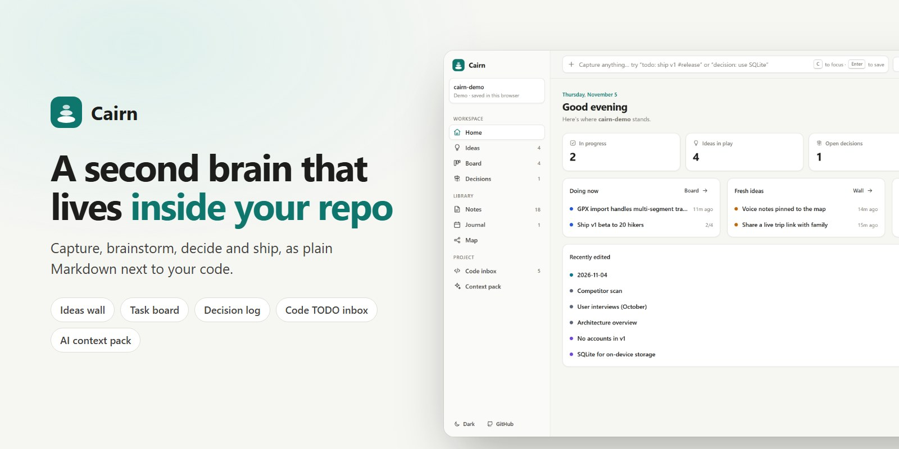
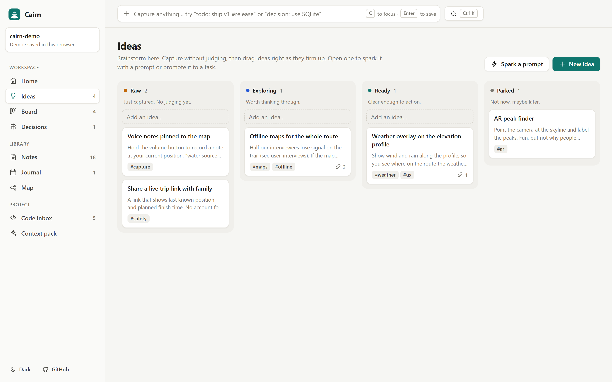

<!-- HERO:START -->
<p align="center">
  <a href="https://juw12.github.io/cairn/"></a>
</p>

<p align="center">
  <b>A second brain that lives inside your repo.</b><br>
  Capture ideas, brainstorm, record decisions and move tasks, all as plain Markdown next to your code.
</p>

<p align="center">
  <a href="https://juw12.github.io/cairn/?demo=1"><b>Try it live</b></a> ·
  <a href="#see-it-in-action">See it in action</a> ·
  <a href="#highlights">Highlights</a> ·
  <a href="https://juw12.github.io/p/cairn/">Landing page</a> ·
  <a href="https://github.com/juw12">More by juw12</a>
</p>

<p align="center">
  <a href="https://github.com/juw12/cairn/actions/workflows/tests.yml"></a>
  <a href="https://github.com/juw12/cairn"></a>
  <a href="https://juw12.github.io/cairn/?demo=1"></a>
  
  
  
  
</p>

<a id="highlights"></a>
<table>
  <tr>
    <td width="33%" valign="top">
      <b>Plain files, no lock-in</b><br>
      Everything is Markdown in a <code>brain/</code> folder. Delete Cairn and it still reads fine on GitHub, in Obsidian or in VS Code.
    </td>
    <td width="33%" valign="top">
      <b>Knows your code</b><br>
      Turns <code>TODO</code>/<code>FIXME</code> comments into tasks that remember the file and line, and commits the brain in one click.
    </td>
    <td width="33%" valign="top">
      <b>Made for AI assistants too</b><br>
      One click writes <code>brain/CONTEXT.md</code>, a project brief Copilot, Claude, Cursor or ChatGPT can read. No API keys.
    </td>
  </tr>
</table>

## See it in action

<p align="center">
  <a href="https://juw12.github.io/cairn/?demo=1"></a><br>
  <sub>Open the interactive demo at <a href="https://juw12.github.io/cairn/?demo=1">juw12.github.io/cairn</a></sub>
</p>
<!-- HERO:END -->

## About

**Your project's thinking is scattered.** Ideas sit in Notion, tasks in GitHub Issues, decisions
in Slack threads, TODOs in code comments, and the "why" lives in someone's head. Obsidian and
Notion are great at notes, but neither knows anything about your repo.

Cairn puts one calm place **inside the project**, built around how project work actually moves:

```
capture  →  brainstorm  →  decide  →  do  →  remember
  bar        ideas wall    decision    board    notes, journal,
  + CLI      + sparks      log                  map, context pack
```

| Screen | What it does |
|---|---|
| **Quick capture** | One bar on every screen. `todo: ship v1 #release`, `decision: use SQLite`, `log: fixed the bug` or just text (an idea). It shows where the note will go before you press Enter. |
| **Ideas wall** | Raw → Exploring → Ready → Parked. Drag ideas right as they firm up. **Spark** drops a thinking prompt into an idea; **Promote to task** creates a linked task. |
| **Board** | To do → Doing → Done with drag and drop, checklists and progress bars. |
| **Decisions** | Lightweight decision records (context, options, decision, consequences), numbered and reviewed in PRs like code. |
| **Notes, Journal, Map** | Markdown editor with preview, `[[wikilinks]]`, backlinks, tags, a page per day and a graph of how everything connects. |
| **Code inbox** | Every `TODO`, `FIXME` and `HACK` comment in the repo. One click makes a task that remembers `file:line`. |
| **Context pack** | A one-page brief (doing now, up next, decisions in force, open questions) saved as `brain/CONTEXT.md` for teammates and AI assistants. |
| **Search** | <kbd>Ctrl</kbd>/<kbd>⌘</kbd>+<kbd>K</kbd> across every note and command. <kbd>C</kbd> jumps to capture. |
| **People** | Look up anyone on GitHub and see their proof of work, read from their brain's files: working on, shipped, decisions, open to collaborate. Open their brain read-only and **Ask to join** (opens a prefilled GitHub issue). |

## Use it

There are four ways to run it. All of them read and write the same plain files.

**0. Desktop app for Windows (easiest).** [Download `Cairn-Setup.cmd`](https://juw12.github.io/cairn/Cairn-Setup.cmd)
and double-click it, or paste this in PowerShell: `irm https://juw12.github.io/cairn/install.ps1 | iex`.
No admin rights needed. It installs whatever is missing (Python, Git, the window and tray libraries), then opens
Cairn in its own window. After that, everything happens inside the app:

- **Your notes open by themselves.** The first time, Cairn opens the Obsidian vault you used last (or a fresh
  brain in `Documents\Cairn`). **Switch brain** opens another folder, **gets a repo from GitHub** (private
  ones too; GitHub's own sign-in window appears once), or starts a new brain.
- **One Sync button.** It saves your edits, gets everyone else's and sends yours (commit + pull + push). It also
  runs on its own every 10 minutes. If two people changed the same lines, nothing is lost: your edits stay
  committed locally and Cairn tells you.
- **Always there.** Closing the window keeps Cairn in the tray; it starts with Windows and updates itself.
  **Settings** turns each of these on or off and checks for updates.

**1. Local app from the terminal.** Python 3.10+, no dependencies:

```bash
git clone https://github.com/juw12/cairn
cd your-project
python -m cairn --root .          # run from the cairn folder, or `pip install ./cairn` and run `cairn`
```

It opens `http://127.0.0.1:4777` with code scanning and one-click **Commit brain** (commits only `brain/`; push with your usual git tool).

**2. In the browser, on your real repo.** Open [juw12.github.io/cairn](https://juw12.github.io/cairn/), choose
**Open a repo folder**, and pick your project. Chrome and Edge on desktop can read and write the folder directly
(File System Access API). Nothing is uploaded.

**3. Demo.** [Try the sample project](https://juw12.github.io/cairn/?demo=1) (an offline hiking app). It's saved only in your browser.

### Share your brain and explore others

Cairn uses GitHub as the network, so there is nothing new to sign up for.

1. Keep `brain/` in a **public** repo and add the topic `cairn-brain` (repo page → About → Topics).
2. Share your profile link: `https://juw12.github.io/cairn/?u=<your-username>`, or a brain directly:
   `https://juw12.github.io/cairn/?brain=<owner>/<repo>`.

This repo dogfoods it: see [@juw12's profile](https://juw12.github.io/cairn/?u=juw12) or
[Cairn's own brain](https://juw12.github.io/cairn/?brain=juw12/cairn). Only repos with the topic ever appear;
other people's brains are always read-only. Unsigned GitHub API calls are limited to 60 per hour per IP, so
results are cached for 10 minutes.

### Edit your brain from any device

Sign in with GitHub on the web app and your brain repo becomes editable from your phone, a borrowed laptop or
any browser. Every save is a commit to `brain/` in your repo; there is still no Cairn server or database.

1. Open [juw12.github.io/cairn](https://juw12.github.io/cairn/) → **Sign in with GitHub**.
2. Paste a token. The dialog links to a [pre-filled fine-grained token](https://github.com/settings/personal-access-tokens/new?name=Cairn&expires_in=90&contents=write)
   (name, 90-day expiry and *Contents: Read and write* filled in; you pick *Only select repositories* and your
   brain repo). That is the narrowest access. A [classic token with `public_repo`](https://github.com/settings/tokens/new?scopes=public_repo&description=Cairn)
   also lets you create new brains from the People page.
3. You land in your brain (the one you last edited, or your only one). Edit as usual: typing is batched, so a
   burst of edits becomes one commit.

If the same note was changed somewhere else, Cairn shows the newer version and keeps yours next to it
(*Use my version*, *Copy my text* or *Keep the newer one*). Failed saves (offline, expired sign-in) keep your text
the same way. Repos you can't push to stay read-only.

Or click **Continue with GitHub**: approve on github.com with a short code, no token to copy. GitHub's OAuth
endpoints don't allow browser calls, so this goes through a tiny Cloudflare Worker that holds no secret and
forwards only those two requests: see [`worker/README.md`](worker/README.md).

### Use it with your Obsidian vault

Cairn opens an Obsidian vault as it is: no import, no copy, no `brain/` folder needed. A folder with
`.obsidian/` in it (or a GitHub repo of notes) is used directly, `.obsidian/`, `.trash/` and other
hidden folders are skipped, and links resolve the way Obsidian resolves them: `[[folder/note|alias]]`,
`[[note#heading]]`, `![[embeds]]`, `[text](note.md)` and wiki links in properties.

- **On this computer:** `python -m cairn --root "path/to/your vault" serve`, or *Choose a folder* in the browser.
- **On any device:** keep the vault in a GitHub repo (the Obsidian Git plugin can push and pull it),
  sign in and open `you/your-vault`.

Edits only change what you changed: properties keep their order, comments and list style, and files
keep their line endings, so Obsidian and git see clean one-line diffs.

The Map goes further than Obsidian's graph: filters, colour by type, folder, cluster or tag, local maps
of depth 1 to 3, the shortest path between two notes, keyboard navigation (arrow keys walk the links,
Enter opens, L for local), hubs, orphans and islands at a glance, and *suggested links*: notes that
mention another note's title without linking it, linked in one click.

### Command line

```bash
cairn init                               # create brain/ (never overwrites)
cairn add "todo: ship v1 #release"       # capture from the terminal
cairn add "decision: use SQLite"         # → brain/decisions/0001-use-sqlite.md
cairn list --type task --status doing
cairn todos                              # TODO/FIXME/HACK comments in the code
cairn context                            # write brain/CONTEXT.md
cairn serve --port 4777                  # the app (default command)
```

## The data format

```
your-repo/
  brain/
    ideas/      offline-maps.md
    tasks/      ship-v1.md
    decisions/  0001-use-pmtiles.md
    notes/      architecture.md
    journal/    2026-11-05.md
    CONTEXT.md  (generated)
    README.md   (explains the folder to people who don't use Cairn)
```

```markdown
---
title: Ship v1
type: task            # idea | task | decision | note | journal
status: doing         # idea: raw/exploring/ready/parked · task: todo/doing/done · decision: proposed/accepted/superseded
tags: [release, web]
created: 2026-11-05
source: src/app.py:42 # optional: where in the code this came from
---
Plain Markdown. Link other notes with [[offline-maps]].
```

* File names are the links, so `[[offline-maps]]` resolves in **Obsidian** and **Foam** too. Open `brain/` as an Obsidian vault if you like.
* Fields Cairn doesn't know (aliases, other plugins' data) are preserved when it saves.
* If a note changed in another editor since you opened it, Cairn loads the newer version instead of overwriting it.

### Make your AI assistant use it

Add one line to `AGENTS.md`, `CLAUDE.md` or `.github/copilot-instructions.md`:

```
Read brain/CONTEXT.md before starting. Decisions in brain/decisions/ marked "accepted" are binding.
```

## Why

| Tool | Great at | Missing for "a brain inside the project" |
|---|---|---|
| Notion | Databases, dashboards | Lives in its cloud: not diffable, not reviewable, invisible to tools that read the repo |
| Obsidian | Linking local Markdown | Knows nothing about the repo: no code TODOs, no git, no project flow without plugin setup |
| Foam (VS Code) | Wikilinks in the editor | Editor-locked; no board or brainstorm flow |
| GitHub Issues/Projects | Tracking work | Heavy for half-formed ideas; needs network; not a thinking tool |

Cairn doesn't replace them. It's the thin layer that keeps a project's ideas, decisions and next steps
**with the code**, in a format all of those tools (and your AI assistant) can read.

## Privacy and security

* No Cairn account and no telemetry. Fonts (SIL OFL) and icons are bundled.
* The only external requests are to `api.github.com` and `raw.githubusercontent.com`, and only when you look someone up, open a published brain or sign in. A local brain never leaves your machine.
* Signing in is optional. Your token is kept in this tab only (`sessionStorage`) unless you tick *Remember on this device*; it is sent only to `api.github.com` (tested), and *Sign out* deletes it. With the optional Worker, the device-flow token passes through your own Worker once on its way back to the browser.
* The local server binds to `127.0.0.1` only, checks the `Host` header and requires a custom header on every API call, so other websites can't reach it.
* It reads and writes only `.md` files inside the brain folder; paths that escape it are refused (tested).

## Development

```bash
python -m unittest discover -s tests          # 56 tests: core, API, CLI, parity, e2e, sign-in, Worker
pip install playwright && playwright install chromium   # for the parity and e2e tests
python scripts/make_media.py                  # regenerate the banner and screenshot
python scripts/live_github_check.py           # sign-in + edits against the real GitHub API on a throwaway repo
```

The web app in `docs/` is plain HTML, CSS and ES modules with no build step. `cairn/core.py` and
`docs/core.js` implement the same rules and are checked against each other by `tests/test_parity.py`.
Design rationale (type, colour and the psychology behind it): [`plan/DESIGN.md`](plan/DESIGN.md).
How it was planned and scored: [`PLAN.md`](PLAN.md), [`plan/rubric.md`](plan/rubric.md), [`plan/refine_log.md`](plan/refine_log.md).

## License

[MIT](LICENSE) © Juwen Lie. An independent personal project.
